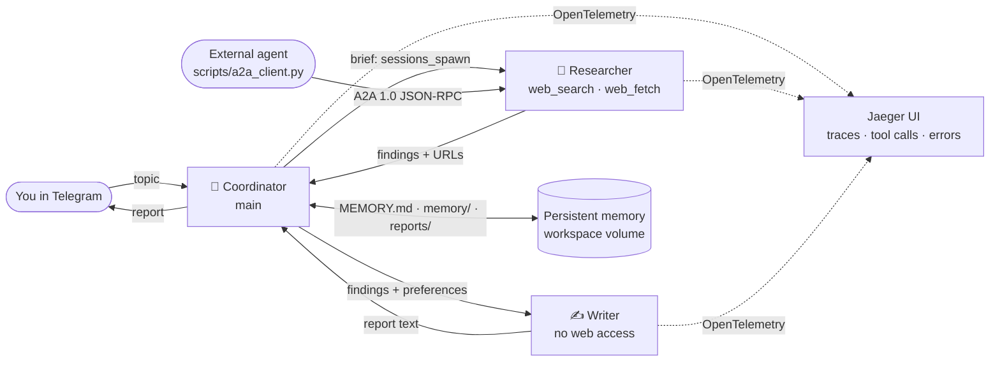

# Research Report Agent Team

A working multi-agent system that solves one real task: **you send a topic in
Telegram, and a team of agents researches it on the web, writes a sourced
report, sends it back, and remembers your preferences and past reports.**

Built on [OpenClaw](https://github.com/openclaw/openclaw) `2026.9.8` in Docker,
with Jaeger for tracing. Developed and tested on **Windows 10/11 + Docker
Desktop**; the same Docker commands work on macOS and Linux.



## How the homework requirements are covered

| # | Requirement | Implementation | How to check |
| --- | --- | --- | --- |
| 1 | ≥2 agents with different roles, instructions and access; a model; a tool or MCP | **Coordinator**, **Researcher**, **Writer** — each has its own workspace and `AGENTS.md`. Tool limits in [`config/openclaw.json`](config/openclaw.json): Writer has no web tools; Researcher and Writer cannot delegate; only the Coordinator can; nobody can run shell commands; file access is limited to each agent's own workspace. Model: OpenAI `gpt-5.5`. Tools: `web_search` (key-free [Parallel Search](https://docs.parallel.ai/integrations/mcp/search-mcp) plugin), `web_fetch`, `read`/`write`, `memory_search`/`memory_get`, `sessions_spawn`. | [Step 3](#step-3--check-the-agents-and-their-boundaries) |
| 2 | Persistent memory reused after a restart in a new conversation | Markdown memory files in each workspace (`MEMORY.md`, `memory/*.md`, `reports/`) on the Docker volume `openclaw-workspace`, plus OpenClaw's memory search. Sessions and auth live in the volume `openclaw-state`. | [Step 5](#step-5--persistent-memory-across-a-restart) |
| 3 | Communication channel | **Telegram** bot (long polling, no public URL) bound to the Coordinator. | [Step 4](#step-4--order-a-report-in-telegram) |
| 4 | Collaboration via A2A | (a) Inside the team: Coordinator → Researcher → Coordinator → Writer handoffs with `sessions_spawn`/`sessions_yield`. (b) The standard **A2A 1.0 protocol**: public Agent Card + authenticated JSON-RPC endpoint; an external agent ([`scripts/a2a_client.py`](scripts/a2a_client.py)) delegates to the Researcher. | [Step 4](#step-4--order-a-report-in-telegram), [Step 6](#step-6--a2a-protocol-from-an-external-agent) |
| 5 | Observability | **Jaeger** receives OpenTelemetry traces from OpenClaw's `diagnostics-otel` plugin: every run, model call, tool call (incl. `sessions_spawn` handoffs), channel, outcome and error, tagged with the agent. The OpenClaw **Control UI** additionally shows each session's transcript and child sessions. | [Step 7](#step-7--observability-in-jaeger-and-the-dashboard) |

## Prerequisites

- Windows 10/11 with [Docker Desktop](https://docs.docker.com/desktop/setup/install/windows-install/)
  (WSL 2 backend) running. About 6 GB free disk; 4 GB RAM for Docker is enough.
- [Git](https://git-scm.com/download/win).
- An **OpenAI API key** with access to `gpt-5.5`
  ([platform.openai.com/api-keys](https://platform.openai.com/api-keys)). A full
  report run costs a few cents.
- A **Telegram** account.
- Optional: Python 3.9+ (only for the unit tests and running the A2A client on the host).

No Node.js, OpenClaw, or Python installation on the host is required:
everything runs in containers. Ports used (loopback only): `18789` (OpenClaw)
and `16686` (Jaeger).

## Setup

### Step 1 — Clone

```powershell
git clone https://github.com/<you>/<this-repo>.git
cd <this-repo>
```

### Step 2 — Create the Telegram bot and run setup

1. In Telegram open [@BotFather](https://t.me/BotFather), send `/newbot`, pick
   a name and username, and copy the token it gives you.
2. Run setup. The first run creates the private file `.local\openclaw.env`
   (ignored by Git), generates the dashboard and A2A tokens, and opens it in
   Notepad:

   ```powershell
   powershell -ExecutionPolicy Bypass -File .\setup.ps1
   ```

3. In Notepad fill `OPENAI_API_KEY=` and `TELEGRAM_BOT_TOKEN=`, save, close.
4. Run the same command again. It pulls the pinned images (~3.5 GB on first
   run), installs the agent config into the Docker volume, registers the
   OpenAI key for all three agents and starts the containers. The first
   gateway start takes 3–5 minutes. It ends with:

   ```text
   ==> Done
   Dashboard (OpenClaw Control UI): http://127.0.0.1:18789
   Tracing (Jaeger UI):              http://127.0.0.1:16686   service: openclaw-research-team
   ```

`setup.ps1` is safe to re-run at any time (after editing the config, or to add
the Telegram token later); tokens, memory and sessions are kept.

All later commands use this shortcut for the OpenClaw CLI inside the container:

```powershell
function oc { docker compose exec openclaw openclaw @args }
```

### Step 2b — Log in to the dashboard and pair Telegram

**Dashboard.** Open <http://127.0.0.1:18789>. Paste `OPENCLAW_GATEWAY_TOKEN`
from `.local\openclaw.env` into the login form. If it says *pairing required*,
approve your browser:

```powershell
oc devices list
oc devices approve <requestId>
```

**Telegram.** Send any message (e.g. `hi`) to your bot. It answers with a
pairing code. Approve it:

```powershell
oc pairing list telegram
oc pairing approve telegram <CODE>
```

Only approved Telegram accounts can talk to the bot.

**Smoke test.** Send `Reply with just: Ready` to the bot (or in the dashboard
chat). A reply proves the model key works, not only container health.

## Run the scenario

Each step below demonstrates one homework requirement. Example messages are
in Ukrainian; any language works.

### Step 3 — Check the agents and their boundaries

```powershell
oc agents list
oc config get agents.entries.researcher.tools
oc config get agents.entries.writer.tools
oc config get tools.deny
```

Expected: `main (Coordinator)`, `researcher (Researcher)`, `writer (Writer)`;
Writer denies `group:web`; Researcher and Writer deny `sessions_spawn`;
`exec` is denied globally; `main` has no per-agent deny list.

Why the Coordinator has no `group:web` deny: in OpenClaw a spawned child runs
under its parent's tool policy as well as its own, so denying web tools on the
Coordinator would also strip them from the Researcher it delegates to. The
Coordinator is kept out of research by its instructions instead, and the
Jaeger traces (Step 7) show that `web_search` and `web_fetch` are called only
by `researcher`. Role instructions:
[Coordinator](openclaw/workspace/AGENTS.md),
[Researcher](openclaw/workspace/agents/researcher/AGENTS.md),
[Writer](openclaw/workspace/agents/writer/AGENTS.md).

Boundary test — in the dashboard pick the **Writer** agent and ask
`Find today's EUR/UAH exchange rate on the web.` It has no web tool and says
so; the Jaeger trace for that run contains no `web_*` tool span.

### Step 4 — Order a report in Telegram

1. Teach a preference first (used in Step 5):

   > Запам'ятай: мої звіти мають бути українською, до 400 слів, обов'язково з розділом «Джерела».

   The Coordinator writes it to `openclaw/workspace/MEMORY.md` and confirms.

2. Order a report:

   > Підготуй звіт: які open-source фреймворки для мультиагентних систем найпопулярніші у 2026 році та чим вони відрізняються?

What happens (2–5 minutes):

- Coordinator replies that the team started, then calls `sessions_spawn` →
  **Researcher** (web search + fetch, saves `memory/sources-<topic>.md`).
- Coordinator passes the findings to **Writer** via `sessions_spawn`; Writer
  saves `output/<date>-<slug>.md` in its workspace and returns the text.
- Coordinator saves `openclaw/workspace/reports/<date>-<slug>.md`, adds a line
  to `memory/report-index.md`, and sends you the report naming who did what.

The files live in the Docker volume. Read them from PowerShell:

```powershell
docker compose exec openclaw cat /project/openclaw/workspace/MEMORY.md
docker compose exec openclaw cat /project/openclaw/workspace/memory/report-index.md
docker compose exec openclaw ls -R /project/openclaw/workspace/reports /project/openclaw/workspace/agents
```

Or copy the whole workspace to a Windows folder (ignored by Git) to open it in
an editor:

```powershell
docker compose cp openclaw:/project/openclaw/workspace .\workspace-snapshot
```

### Step 5 — Persistent memory across a restart

```powershell
docker compose restart openclaw
```

Wait until <http://127.0.0.1:18789/healthz> answers (1–3 minutes), then in
Telegram send `/new` (starts a fresh conversation without history) and ask:

> Які звіти ми вже робили і які в мене вимоги до формату звітів?

The Coordinator answers from `MEMORY.md` and `memory/report-index.md` — the
preference from Step 4 and the report topic — although the new conversation
has no previous messages. Ordering a new report now applies the preference
without repeating it. Memory also survives `docker compose down` / `up -d`
because it is stored in the `openclaw-workspace` volume (only `down -v`
deletes it).

### Step 6 — A2A protocol from an external agent

The gateway publishes a standard A2A Agent Card and accepts authenticated
JSON-RPC tasks, routed to the Researcher:

```powershell
Invoke-RestMethod http://127.0.0.1:18789/.well-known/agent-card.json | ConvertTo-Json -Depth 5
```

Run the external agent in its own container on the compose network (the
bearer token comes from the private env file and is never printed):

```powershell
docker compose run --rm --no-deps -v ./scripts:/scripts:ro --entrypoint python3 openclaw /scripts/a2a_client.py --url http://openclaw:18789 "Find 3 recent sources about the A2A protocol and summarise each in one line."
```

Expected output: `[discover] Agent Card: Researcher | protocol 1.0 JSONRPC`,
`[task] … state=TASK_STATE_WORKING`, polling, then `TASK_STATE_COMPLETED` and
the Researcher's answer. A wrong token is rejected (see `channels.a2a` in the
config). With Python on the host: `python scripts/a2a_client.py "<question>"`.

### Step 7 — Observability in Jaeger and the dashboard

Open <http://127.0.0.1:16686>, choose service **openclaw-research-team**,
click **Find Traces**. Useful spans and tags:

| Span | Shows |
| --- | --- |
| `openclaw.message.processed` | an incoming message: `openclaw.channel` = `telegram` / `a2a` / `webchat`, outcome |
| `openclaw.run`, `openclaw.harness.run` | one agent run: `openclaw.agent` = `main` / `researcher` / `writer`, outcome |
| `openclaw.model.call` | each LLM call: model, tokens, latency, `error.type` on failures |
| `openclaw.tool.execution` | each tool call: `gen_ai.tool.name` (`sessions_spawn` = handoff to a teammate, `web_fetch`, `memory_search`, `write`…), blocked/denied calls, errors |
| `openclaw.context.assembled` | prompt/context sizes |

Search by tag, e.g. `openclaw.agent=researcher` or `error=true`. Content
capture is on (`diagnostics.otel.captureContent`), so tool spans include the
handoff brief and results — keep Jaeger on localhost.

To see an error trace on purpose, temporarily put a wrong `OPENAI_API_KEY` in
`.local\openclaw.env`, rerun `setup.ps1`, and send any message: the trace shows
`openclaw.model.call` with an error and `openclaw.message.processed` with
outcome `error`. Restore the key and rerun `setup.ps1`.

In the **Control UI** (<http://127.0.0.1:18789>) → **Sessions**, open the
Coordinator's Telegram session: the transcript shows each tool call with its
arguments and result, and the child sessions of Researcher and Writer.

Jaeger keeps traces in memory; they reset when the Jaeger container restarts.

## Operate

```powershell
docker compose ps                         # status
docker compose logs --tail=80 openclaw    # gateway logs (may contain private data)
docker compose stop                       # stop, keep everything
docker compose up -d                      # start again
oc channels status --probe                # Telegram / A2A health
```

- **Change the model**: edit `agents.defaults.model.primary` and the matching
  key under `agents.defaults.models` in `config/openclaw.json`, then rerun
  `setup.ps1`. List available models with `oc models list --provider openai`.
- **Change agent behaviour**: edit `openclaw/workspace/**/AGENTS.md` (or
  `SOUL.md`, `IDENTITY.md`) in the repository and rerun `setup.ps1`; it copies
  the instruction files into the workspace volume without touching memory.
  New conversations pick them up (`/new` in Telegram).
- **Why a volume, not a bind mount**: on Docker Desktop for Windows a file
  handle stops working after a rename on bind-mounted folders, and OpenClaw's
  atomic file writes check exactly that, so every agent `write` failed. The
  live workspace therefore lives in a Linux volume.
- **Back up memory**: `docker compose cp openclaw:/project/openclaw/workspace .\workspace-snapshot`.
- **Reset everything** (deletes sessions, pairing, the stored key **and all
  agent memory and reports**): `docker compose down -v`.

## Troubleshooting

| Symptom | Fix |
| --- | --- |
| `setup.ps1` cannot be loaded (execution policy) | Use the full command `powershell -ExecutionPolicy Bypass -File .\setup.ps1`. |
| Gateway unhealthy for >5 min | `docker compose logs --tail=80 openclaw`; give Docker Desktop ≥4 GB RAM. |
| Bot does not answer | `oc channels status --probe`; check the token; approve pairing (Step 2b). |
| `401` / authentication failed in replies | Wrong `OPENAI_API_KEY`: fix it in `.local\openclaw.env`, save, then **rerun `setup.ps1`** — the container only reads that file when setup recreates it, so saving alone changes nothing. |
| Model not available for your key | Pick another model (see *Change the model*). |
| No traces in Jaeger | Traces arrive ~5 s after a run; check `docker compose ps jaeger`. |

## Repository layout

```text
setup.ps1                     one-command Windows setup (idempotent)
docker-compose.yml            OpenClaw gateway + Jaeger, ports on 127.0.0.1 only
config/openclaw.json          agents, tool boundaries, Telegram, A2A, tracing (no secrets)
docker/init.py                installs the config into the volume, keeps runtime state
.env.example                  template for the private .local/openclaw.env
openclaw/workspace/           Coordinator workspace (AGENTS.md, SOUL.md, IDENTITY.md, ...)
  agents/researcher/          Researcher workspace and instructions
  agents/writer/              Writer workspace and instructions
  knowledge/                  optional shared notes all agents can search
                              (setup copies this folder into the workspace volume)
scripts/a2a_client.py         external A2A agent (standard library only)
scripts/check_*.py, test_*.py privacy/publication checks and unit tests
setup-notes.md                what was verified, versions, known limits
```

## Security notes

- Secrets live only in `.local/openclaw.env` and the Docker volume; both are
  outside Git. The tracked config references them as `${VAR}` / env SecretRefs.
- Both web UIs listen on `127.0.0.1` only. Telegram uses outbound long polling.
- Telegram access requires pairing approval; A2A requires a bearer token.
- Agents cannot run shell commands, and file tools are limited to each
  agent's own workspace.
- Live memory, reports and agent outputs are ignored by Git (see `.gitignore`).

Before publishing a fork, run the checks:

```powershell
python -m unittest discover -s scripts -p "test_*.py"
python scripts/check_config_privacy.py
python scripts/check_publication.py --history
```
